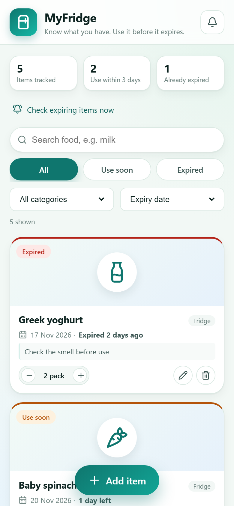

# MyFridge — Fridge & Expiry Tracker PWA

A mobile-first Progressive Web App that keeps track of what is in your fridge, how much of it
is left and when it expires. Built with React 18 and Vite, installable on Android, iOS and
desktop, and fully usable offline.

> COMP10013 Dynamic Web Technologies — Coursework 01 (Part A + Part B reference implementation).



---

## 1. What the app does

| Feature | Where it lives | Module topic it demonstrates |
| --- | --- | --- |
| Full CRUD on fridge items | `src/hooks/useItems.js` | React state, controlled forms |
| Persistence across reloads | `src/hooks/usePersistedState.js` | On-device storage (localStorage) |
| Expiry countdown, status badges, filtering, search, sorting | `src/utils/date.js`, `src/App.jsx` | Derived state, `useMemo` |
| Photo label for each item | `src/hooks/useCamera.js`, `src/components/CameraCapture.jsx` | Device API — MediaDevices / camera |
| Expiry reminders | `src/hooks/useNotifications.js` | Device API — Notifications |
| Installable, offline-first shell | `vite.config.js` (`vite-plugin-pwa`) | PWA — manifest + service worker |
| Clean component architecture, reusable hooks | `src/components`, `src/hooks` | Code quality, hooks |
| CI build on every push | `.github/workflows/ci.yml` | DevOps (Week 8) |

Deliberately scoped: MyFridge does one job well. Every extra feature (photos, reminders) exists
because it makes the core job — *eat food before it expires* — easier.

---

## 2. Tech stack

| Layer | Choice | Why |
| --- | --- | --- |
| UI | React 18 (function components + hooks) | Module content; hooks give small, testable units |
| Build tool | Vite 5 | Instant dev server, tiny production bundles |
| Icons | `lucide-react` | Consistent vector icons, tree-shaken |
| PWA | `vite-plugin-pwa` (Workbox) | Generates manifest + precache service worker |
| Storage | `localStorage` via a custom hook | Synchronous, zero dependencies, ideal for < 5 MB data |
| Deployment | GitHub Pages, `gh-pages` branch (any static host works) | Free HTTPS, required for camera/notification APIs |
| CI | GitHub Actions | Build verification on every push |

No state-management library, no UI framework: at this size, a single `App` container plus
presentational children is simpler to read than Redux or Context.

---

## 3. Project structure

```
myfridge/
├── public/
│   ├── favicon.svg
│   └── icons/                    # 192/512 + maskable PWA icons
├── src/
│   ├── App.jsx                   # only stateful container: filters, modals, composition
│   ├── main.jsx                  # React root
│   ├── styles.css                # design tokens + mobile-first layout + breakpoints
│   ├── constants.js              # categories, places, units, thresholds, STATUS map
│   ├── components/
│   │   ├── AppHeader.jsx         # brand + "enable reminders" + installed pill
│   │   ├── StatsBar.jsx          # total / expiring / expired summary
│   │   ├── FilterBar.jsx         # search, status tabs, category, sort
│   │   ├── ItemCard.jsx          # one item: badge, countdown, qty stepper, actions
│   │   ├── ItemForm.jsx          # create + edit modal with validation
│   │   ├── CameraCapture.jsx     # live preview + shutter + upload fallback
│   │   ├── CategoryIcon.jsx      # category -> lucide icon mapping
│   │   ├── Modal.jsx             # shared accessible dialog shell
│   │   └── EmptyState.jsx        # empty / no-match states
│   ├── hooks/
│   │   ├── useItems.js           # CRUD + derived stats, owns the collection
│   │   ├── usePersistedState.js  # useState mirrored to localStorage
│   │   ├── useCamera.js          # getUserMedia lifecycle + capture + file fallback
│   │   └── useNotifications.js   # permission flow + expiry summary notification
│   └── utils/
│       └── date.js               # countdown, status, formatting (no timezone drift)
├── docs/shots/                  # screenshots used in the report
├── tools/
│   ├── make_icons.py             # regenerates the icon set
│   └── shoot.mjs                 # Puppeteer screenshot script (report figures)
├── .github/workflows/ci.yml      # install -> build on push / PR
├── index.html
├── vite.config.js
└── package.json
```

---

## 4. Getting started

### 4.1 Prerequisites

- Node.js **18 or newer** (developed and verified on Node 22) and npm 9+
- A modern browser: Chrome / Edge 111+, Safari 16.4+, Firefox 115+
- Optional: a phone on the same Wi-Fi network for testing device APIs

### 4.2 Install and run

```bash
# 1. Clone the repository
git clone https://github.com/Jiej-eng/myfridge.git
cd myfridge

# 2. Install dependencies
npm install

# 3. Start the dev server (http://localhost:5173)
npm run dev
```

`npm run dev` prints a **Network** URL. Open that address on your phone (same Wi-Fi) to test the
camera and notification APIs on a real device.

### 4.3 Production build

```bash
npm run build     # outputs a static bundle to dist/
npm run preview   # serves dist/ at http://localhost:4173
```

The build also emits `dist/manifest.webmanifest`, `dist/sw.js` and `dist/workbox-*.js`, which is
what turns the site into an installable PWA.

### 4.4 Deployment (GitHub Pages)

The live site is **https://jiej-eng.github.io/myfridge/** — HTTPS, installable, same bundle as `npm run build`.

GitHub Pages serves project sites from a sub-path (`/<repo>/`), so the build has to know its base URL:

```bash
PAGES_BASE=/myfridge/ npm run build          # Git Bash, macOS, Linux
$env:PAGES_BASE="/myfridge/"; npm run build  # PowerShell
```

`vite.config.js` reads `PAGES_BASE` and uses it for `base`, `manifest.start_url` and `manifest.scope`,
so the installable PWA keeps the right scope under the sub-path. Then publish the build:

```bash
npx gh-pages -d dist -b gh-pages    # or push the folder to an orphan gh-pages branch
```

One server-side step: **Settings → Pages → Source: Deploy from a branch → `gh-pages` / root**.
Every later `npm run build` + push to that branch updates the live site. Any static host works the
same way (Netlify, Cloudflare Pages, Vercel for a root-path URL); **HTTPS is required** for camera,
notifications and service workers — `localhost` is the only exception.

### 4.5 DevOps

The pipeline deliberately stays small enough to keep every step verifiable on a laptop:

| Stage | What happens | Evidence |
| --- | --- | --- |
| Build | `npm ci` then `npm run build` | Fresh clone of this repository builds reproducibly: JS 179.59 kB (gzip 56.64 kB), CSS 14.41 kB, 16 precached entries (201.5 KiB) |
| CI | `.github/workflows/ci.yml` on every push to `main`: checkout → Node 20 → `npm ci` → `npm run build` → upload `dist` | green GitHub Actions run for the current `main` |
| Verify | manual checklist (section 7) on `npm run preview` — the service worker only exists in a production build | screenshots in `docs/shots/` |
| Release | `PAGES_BASE=/myfridge/ npm run build`, then push `dist/` to the `gh-pages` branch | live site at https://jiej-eng.github.io/myfridge/ |
| Rollback | `gh-pages` is a normal branch, so `git revert`/`git reset` on it restores the previous build | — |

`npm ci` (not `npm install`) is used everywhere so a build always matches `package-lock.json`,
which is the same reason a CI runner would use it.

---

## 5. Install it as an app (PWA)

**Android / Chrome**

1. Open the deployed HTTPS URL.
2. Chrome shows an "Install app" prompt, or use ⋮ → *Add to Home screen*.
3. Launch it from the home screen — it opens full-screen (no browser chrome) because
   `display: standalone` is set in the manifest.

**iOS / Safari**

1. Open the URL in Safari (install is not available in Chrome on iOS).
2. Tap the Share icon → *Add to Home Screen* → *Add*.

**Desktop / Chrome or Edge**

Click the install icon in the address bar, or ⋮ → *Install MyFridge*.

After the first load, the service worker precaches the app shell, so opening it with aeroplane
mode still shows your items — the data already lives on the device.

---

## 6. User guide

| Task | Steps |
| --- | --- |
| **Add an item** | Tap **Add item** (floating button) → fill in name, category, quantity + unit, expiry date and where it is stored → optionally tap **Take a photo** → **Add item**. |
| **Read / browse** | The list is sorted by expiry date by default; the badges show *Fresh*, *Use soon* (≤ 3 days) or *Expired*. The header cards summarise totals. |
| **Update** | Pencil icon → change any field → **Save changes**. Or use − / + on the card to adjust how many are left (quantity never drops below 1). |
| **Delete** | Bin icon → confirm **Delete item**. |
| **Search / filter** | Type in the search field (name or note). The **Use soon** and **Expired** tabs filter by status; the Category and Sort dropdowns narrow the list further. |
| **Photo label** | In the form, **Take a photo** opens a live camera preview; **Capture** stores a 720 px JPEG with the item. If the camera is blocked, **Upload instead** uses a file picker. |
| **Expiry reminder** | Tap **Enable reminders** → allow the browser prompt. Then **Check expiring items now** sends a notification listing items due within 3 days. |
| **Demo data** | Open the app with `?demo=1` (e.g. `http://localhost:5173/?demo=1`) to seed five sample items — useful when recording the walkthrough video. |
| **Start over** | **Clear all** in the footer, or `localStorage.clear()` in the console, removes every item on this device. |

### Device API notes

- **Camera (`getUserMedia`)** — asks for permission the first time; the stream is stopped on every
  close, so the camera indicator turns off. Failure modes are mapped to readable messages
  (`NotAllowedError` → permission denied, `NotFoundError` → no camera, `NotReadableError` → busy).
- **Notifications** — permission is only requested from a user gesture (a click), never on load.
  Notifications require the page to be open; a background push would need a server and
  `PushManager`, which is listed as future work.
- Both APIs require a **secure context** (HTTPS or `localhost`).

### Data model

```json
{
  "id": "6f1c…",
  "name": "Whole milk",
  "category": "dairy",
  "quantity": 1,
  "unit": "bottle",
  "expiryDate": "2026-11-21",
  "place": "Fridge",
  "note": "Opened on Monday",
  "photo": "data:image/jpeg;base64,…",
  "createdAt": "2026-11-19T09:12:04.512Z",
  "updatedAt": "2026-11-19T09:12:04.512Z"
}
```

Everything is stored under the single key `myfridge.items.v1`, so a schema change can be migrated
(or discarded) without touching unrelated data.

---

## 7. Manual test checklist

| # | Step | Expected |
| --- | --- | --- |
| 1 | Fresh install, open app | Empty state with "Add first item" |
| 2 | Add "Whole milk", expiry in 2 days | Card appears, amber *Use soon* badge, "2 days left" |
| 3 | Reload / close and reopen the app | Item still there (persistence) |
| 4 | Press **+** twice, then **−** three times | Quantity 1, 2, 3 → cannot go below 1 |
| 5 | Edit the item and change the date to yesterday | Badge turns red, "Expired yesterday" |
| 6 | Search "oat" | Only matching items listed, "0 shown" if none |
| 7 | Delete the item and confirm | Card disappears; reload keeps it deleted |
| 8 | Add a photo via camera | Thumbnail stored, survives reload |
| 9 | Enable reminders, then "Check expiring items now" | System notification lists expiring items |
| 10 | Build, preview, DevTools → Application → Manifest | Name, icons, `standalone` display, service worker active |

---

## 8. Troubleshooting

| Problem | Cause / fix |
| --- | --- |
| Camera never starts | Site not HTTPS (or not `localhost`), permission denied, or another app holds the camera. Check the dialog message and the site settings. |
| "Local storage is full" banner | Photos dominate the 5 MB quota. Remove a photo, or clear old items. |
| Items disappeared | The browser was used in private mode, or site data was cleared. Storage is per browser **and** per origin. |
| Nothing loads offline | The service worker registers on the **first production build/preview**, not in `npm run dev`. Build once, then reload. |
| No install prompt | Already installed, browser unsupported, or the manifest/service worker is missing — check DevTools → Application → Manifest. |
| Notifications blocked | The user dismissed/blocked the prompt; re-enable in site settings, then reload. |

---

## 9. Roadmap

1. **IndexedDB (Dexie)** for photos and a larger catalogue, keeping localStorage for settings.
2. **Background reminders** via a push server (Web Push + `PushManager`) so warnings arrive without opening the app.
3. **Barcode scanning** with `BarcodeDetector` or `zxing-js` to add items by scanning the packet.
4. **Shared household mode** — Laravel/MERN API so two phones see the same fridge.
5. **Automated tests** — Vitest for `utils/date.js` and `useItems`, Playwright for the CRUD flow.
6. **Waste analytics** — how much food and money is thrown away each month.

---

## 10. References

- MDN Web Docs (2025) *MediaDevices: getUserMedia() method*. Available at:
  https://developer.mozilla.org/en-US/docs/Web/API/MediaDevices/getUserMedia (Accessed: 19 November 2026).
- MDN Web Docs (2025) *Notifications API*. Available at:
  https://developer.mozilla.org/en-US/docs/Web/API/Notifications_API (Accessed: 19 November 2026).
- MDN Web Docs (2025) *Window: localStorage property*. Available at:
  https://developer.mozilla.org/en-US/docs/Web/API/Window/localStorage (Accessed: 19 November 2026).
- React (2025) *Hooks reference*. Available at: https://react.dev/reference/react/hooks
  (Accessed: 19 November 2026).
- Vite (2025) *Getting started*. Available at: https://vite.dev/guide/ (Accessed: 19 November 2026).
- Vite PWA (2025) *Vite Plugin PWA documentation*. Available at: https://vite-pwa-org.netlify.app/
  (Accessed: 19 November 2026).
- web.dev (2024) *Progressive Web Apps*. Available at: https://web.dev/explore/progressive-web-apps
  (Accessed: 19 November 2026).

---

## 11. Licence and academic note

Submitted as coursework for COMP10013 at the University of the West of Scotland (Yijie Shen,
B01857661). The repository is public because the brief requires a 24/7 accessible code repository
for assessment.

**Statement of AI use** — AI was used only as a language aid: grammar, spelling and sentence-level
phrasing in this README and in the accompanying report were revised with an AI writing assistant.
No AI tool generated the application's source code, architecture, tests, screenshots or analysis;
every result in this repository was produced and verified by the author.
